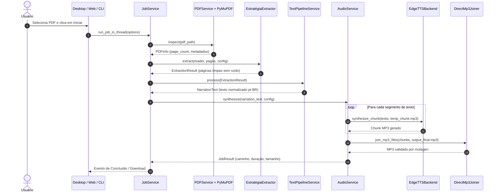

# Arquitetura do Matraca

O Matraca foi projetado segundo os princípios da **Arquitetura Limpa (Clean Architecture)** e **Portas e Adaptadores (Hexagonal)**, garantindo que o núcleo de regras de negócio, extração e normalização permaneça completamente desacoplado de bibliotecas de terceiros (como PyMuPDF, edge-tts, CustomTkinter e Streamlit).

---

## 🏛️ Visão Geral em Camadas

```mermaid
flowchart TD
    subgraph UI["Interfaces do Usuário (Adaptadores de Entrada)"]
        GUI["Desktop (CustomTkinter) + Presenter"]
        WEB["Web (Streamlit) + page_logic"]
        CLI["CLI (argparse) + Doctor"]
    end

    subgraph Core["Domínio e Aplicação (matraca.core)"]
        JOB["JobService (Facade Central)"]
        PDFS["PDFService"]
        PIPE["TextPipelineService"]
        AUDS["AudioService"]
        PSEL["PageSelection (Parser)"]
        PORTS["Ports & Protocols"]
    end

    subgraph Adapters["Adaptadores de Infraestrutura"]
        PYMU["pdf/pymupdf_reader (PyMuPDF)"]
        EXTR["extractors/* (Estratégia Concursos & Layout)"]
        ETTS["audio/edge_tts_client (edge-tts)"]
        JOIN["audio/mp3_writer (Mutagen & MPEG Concat)"]
        TEXT["text/* (Normalização Pura pt-BR)"]
    end

    GUI --> JOB
    WEB --> JOB
    CLI --> JOB

    JOB --> PDFS
    JOB --> PIPE
    JOB --> AUDS
    JOB --> PSEL

    PDFS -.-> PORTS
    AUDS -.-> PORTS
    PORTS <|.. PYMU
    PORTS <|.. EXTR
    PORTS <|.. ETTS
    PORTS <|.. JOIN

    PIPE --> TEXT
```

---

## 🔒 Fronteiras Arquiteturais Rígidas (RNF-01)

1. **Núcleo Puro (`matraca.core`):**
   - Importa apenas a biblioteca padrão do Python e submódulos internos permitidos (`matraca.config`, `matraca.text`, `matraca.audio.chunking`).
   - Não possui importações de `fitz`, `pymupdf`, `edge_tts`, `customtkinter`, `tkinter` nem `streamlit`.
   - Essa invariante é verificada estaticamente por análise de Árvore Sintática Abstrata (AST) no teste `tests/unit/test_architecture.py`.

2. **Adaptadores de Terceiros Isolados:**
   - Cada biblioteca externa é encapsulada em um único arquivo adaptador que implementa um `Protocol` do `core.ports`:
     - `PyMuPDF` (`fitz`) → `matraca/pdf/pymupdf_reader.py` (implementa `PDFReader`)
     - `edge-tts` → `matraca/audio/edge_tts_client.py` (implementa `TTSBackend`)
     - `mutagen` → `matraca/audio/mp3_writer.py` (implementa `Mp3Joiner`)
     - `customtkinter` → `matraca/gui/desktop_app.py`
     - `streamlit` → `matraca/web/streamlit_app.py` e `matraca/web/page_logic.py`

3. **UIs Finas e Sem Lógica de Negócio:**
   - As interfaces gráfica Desktop e Web não contêm lógica de extração, limpeza ou geração de áudio. Ambas delegam 100% das operações para o `JobService`.

---

## 🔄 Fluxo de Processamento de Ponta a Ponta



---

## 🧵 Concorrência e Ciclo de Vida de Threads (ADR-015, ADR-016)

- **Thread de Trabalho Isolada:** O processamento assíncrono de rede e áudio roda em uma `threading.Thread` dedicada inicializada pelo `JobService.run_job_in_thread(...)`.
- **Event Loop Próprio:** Cada thread trabalhadora cria e fecha seu próprio loop `asyncio.new_event_loop()`, prevenindo qualquer interferência com os loops da UI ou de servidores de aplicação.
- **Comunicação Thread-Safe:**
  - No **Desktop**, eventos de progresso e finalização trafegam via `queue.Queue[UIEvent]` para que nenhum widget CustomTkinter seja alterado fora da thread principal de renderização.
  - Na **Web**, o Streamlit realiza sincronização via fila e reatividade de sessão.
- **Cancelamento Cooperativo:** O `CancellationToken` é repassado ao longo de todo o pipeline. Se o usuário solicitar cancelamento, a thread aborta as requisições pendentes e limpa todos os arquivos temporários intermediários.

---

## 📦 Mapa de Módulos e Responsabilidades

| Pacote / Módulo | Responsabilidade Principal |
| :--- | :--- |
| `matraca.core` | Modelos de dados imutáveis, exceções, portas (`Protocol`), parser de seleção de páginas e `JobService`. |
| `matraca.pdf` | Adaptador PyMuPDF para abertura e extração bruta de caixas de texto (`bbox`). |
| `matraca.extractors` | Detecção de colunas (`layout.py`), remoção de ruídos (`noise.py`) e extratores (`estrategia_concursos.py`). |
| `matraca.text` | Pipeline de 9 etapas de normalização textual pt-BR (leis, artigos, incisos, números, datas, prosódia). |
| `matraca.audio` | Segmentação inteligente (`chunking.py`), cliente `edge_tts`, backend fake para testes e junção atômica de MP3. |
| `matraca.gui` | Interface Desktop com CustomTkinter e padrão MVP (`presenter.py` testável sem display). |
| `matraca.web` | Interface Web com Streamlit (`page_logic.py` e `streamlit_app.py`) com isolamento de temporários de sessão. |
| `matraca.doctor` | Diagnóstico de integridade do ambiente e teste de conectividade TTS. |
| `matraca.cli` | Interface de linha de comando para automação e execução em servidores sem interface gráfica. |

---

## 📜 Registro de Decisões Técnicas (ADRs)

Para o histórico detalhado, motivação técnica e critérios de escolha de cada decisão de design, consulte o documento:
👉 [docs/DECISOES_TECNICAS.md](file:///home/manoel/Projects/matraca/docs/DECISOES_TECNICAS.md)
