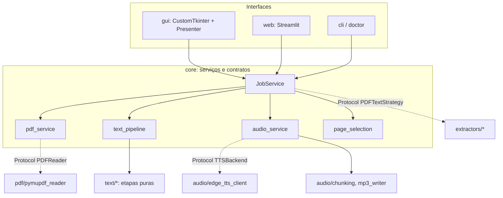

# Arquitetura

## Camadas

## Regras
- `core/` não importa `gui`, `web`, `streamlit`, `customtkinter`, `edge_tts` nem `fitz` (teste AST na Fase 1).
- Interfaces chamam apenas `JobService`.
- Configuração por `dataclass(frozen=True)`; sem estado global mutável.

## Fluxo de dados
PDF → `PDFReader` → `PDFTextStrategy.extract` (`ExtractionResult`) → `text_pipeline` (`NarrationText`) → `chunking` → `TTSBackend` (segmento a segmento, em temporário) → `Mp3Joiner` → escrita atômica `.part` → `os.replace` → validação.

## Ordem das etapas de normalização
(definida e fixada por teste na Fase 3)

## Concorrência
(definida em ADR na Fase 4)
