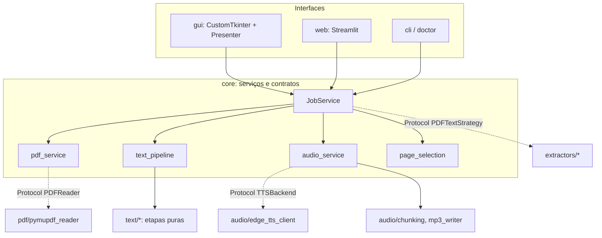

# Arquitetura

## Camadas

## Regras
- `core/` não importa `gui`, `web`, `streamlit`, `customtkinter`, `edge_tts` nem `fitz` (teste AST na Fase 1).
- Interfaces chamam apenas `JobService`.
- Configuração por `dataclass(frozen=True)`; sem estado global mutável.

## Fluxo de dados
PDF → `PDFReader` → `PDFTextStrategy.extract` (`ExtractionResult`) → `text_pipeline` (`NarrationText`) → `chunking` → `TTSBackend` (segmento a segmento, em temporário) → `Mp3Joiner` → escrita atômica `.part` → `os.replace` → validação.

## Ordem das etapas de normalização (Fase 3, A.13.3)
1. `cleanup_unicode`: normalização Unicode NFC, remoção de largura zero, caracteres de controle e aspas.
2. `reconstruct_lines`: desfaz hifenização de fim de linha (`pala-\nvra` -> `palavra`) e une quebras de frase.
3. `legal_abbreviations`: abreviações jurídicas (`Art.`, `§`, `c/c`, `p. ex.`, `nº`).
4. `laws_and_dates`: leis (`Lei 8.666/93`, `Decreto-Lei 200/67`) e datas por extenso antes de numerais genéricos.
5. `currency_and_percents`: moeda (`R$ 1.250,00`) e porcentagem (`10%`, `2,5%`).
6. `articles_and_incisos`: artigos (ordinais 1-9 / cardinais 10+), parágrafos e incisos cardinais.
7. `numbers`: números com separador de milhar e decimais.
8. `acronyms`: siglas jurídicas e de concursos configuráveis (`CF/88`, `STF`, etc.).
9. `adjust_prosody`: espaçamento, pausas e pontuação final.

## Concorrência
(definida em ADR na Fase 4)
